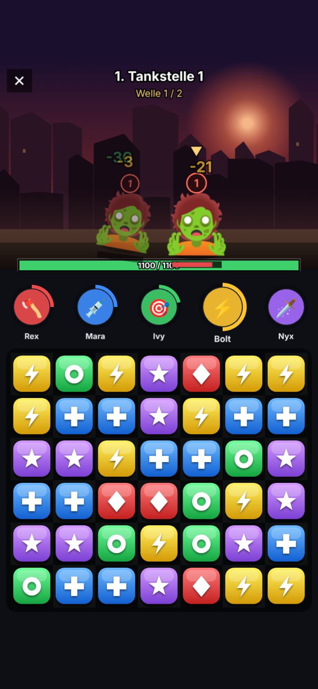
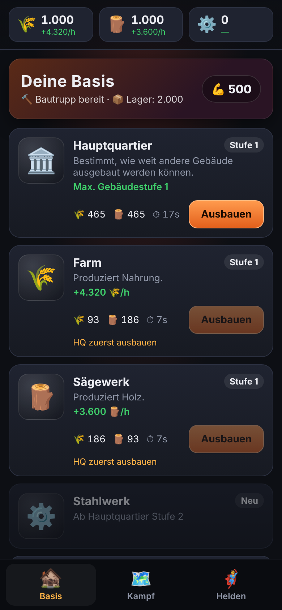
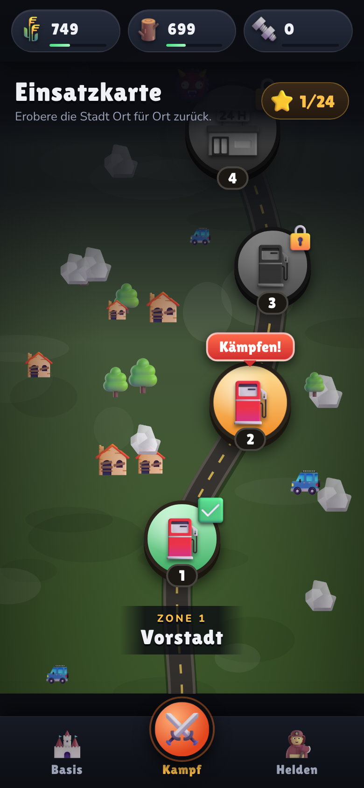
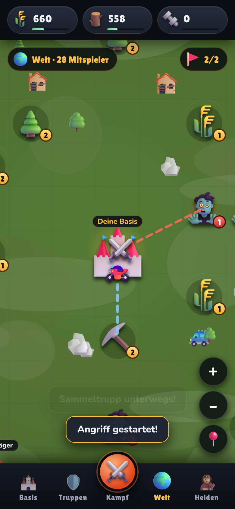
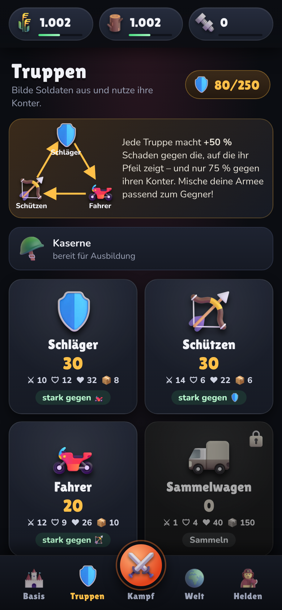
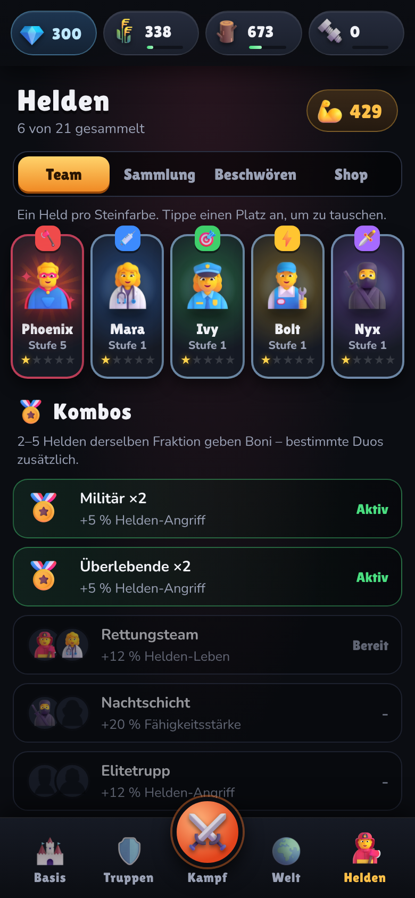

# Survival Puzzle

Handy-Spiel im Stil von *Puzzles & Survival*: **Match-3-Kämpfe gegen Zombie-Wellen** und
**Basisbau** mit Rohstoffen, Bauzeiten und Helden-Training.

| Kampf | Basis | Karte |
| --- | --- | --- |
|  |  |  |
| **Weltkarte** | **Truppen** | **Helden** |
|  |  |  |

## Spielprinzip

- **Kampf:** Tausche benachbarte Steine, um 3 oder mehr gleiche in eine Reihe zu bringen. Jede Farbe gehört zu
  einem Helden – triffst du seine Farbe, greift er an. Kettenreaktionen geben Kombo-Bonus.
  - 4 in einer Reihe → **Linienstein** (räumt eine Reihe/Spalte), 5 in einer Reihe oder L/T-Form → **Bombe** (3×3)
  - Die Zahl über jedem Zombie zeigt, in wie vielen Zügen er angreift.
  - Getroffene Steine laden die Helden auf. Volle Helden antippen → **Fähigkeit** (kostet keinen Zug).
- **Kampf-Extras:** Panzer-Zombies (Schild), Explodierer (werfen Kisten), Seuchen-Doktoren (heilen),
  Kisten und Eis auf dem Feld, 1–3 Sterne pro Level mit Sterne-Truhen.
- **Events:** täglicher Titan-Angriff (15 Züge, Schaden zählt, 6 Belohnungsstufen) und Dungeons je Wochentag
  (Stahl-Labor, Holzfäller-Lager, Helden-Friedhof) mit 3 Schwierigkeiten.
- **Basis:** Farm, Sägewerk und Stahlwerk produzieren auch offline.
  Forschungszentrum mit 11 Technologien, Lazarett für verletzte Soldaten, Beschleuniger und Inventar. Das Lager begrenzt die Menge,
  die Schutzmauer gibt mehr Lebenspunkte im Kampf. Das Hauptquartier begrenzt die Stufe aller Gebäude.
- **Helden:** 21 Helden in 4 Seltenheiten (Gewöhnlich, Episch, Legendär, Mythisch) und 4 Fraktionen.
  - Team aus 5 Helden, je einer pro Steinfarbe.
  - **Truppen-Boni** auf der Weltkarte (z. B. „Schläger +14 % Angriff“, „+20 % Sammeltempo“).
  - **Kombos:** 2–5 Helden derselben Fraktion und besondere Duos (z. B. Rex + Mara = Rettungsteam).
  - **Talentbaum** pro Held (Angriff, Verteidigung, Kommando), 1 Punkt pro Stufe, Zurücksetzen kostet Diamanten.
  - **Sterne** über Splitter aus doppelten Helden.
  - **Beschwörung** mit seltenen Diamanten (5 % legendär, garantiert nach 40), mit Portal- und Karten-Animation.
  - **Mythische Helden** nur im Shop (Echtgeld – wird mit dem Server freigeschaltet).
  - **Ausrüstung** (Waffe, Rüstung, Helm) in 3 Seltenheiten, aufwertbar bis Stufe 20, Schmiede, Zerlegen.
  - **Erwachen** ab 5 Sternen: +25 % Werte, +30 % Fähigkeit, stärkere Truppen-Boni, goldener Rahmen.
- **Karte:** 24 Level, alle 4 Level ein Boss.
- **Truppen:** Schläger, Schützen und Fahrer aus der Kaserne – mit Konter-Dreieck
  (Schläger > Fahrer > Schützen > Schläger, +50 % Schaden). Sammelwagen aus der Werkstatt
  tragen 150 statt 6–10 Rohstoffe.
- **Aufgaben:** Hauptaufgaben führen neue Spieler als Tutorial durchs Spiel (Ziel-Banner in der Basis),
  5 tägliche Aufgaben mit Tagestruhe und eine Login-Belohnung über 7 Tage.
- **Musik & Sound:** düstere Musik und Effekte, live erzeugt (keine Audiodateien), Lautstärke in den Einstellungen.
- **Weltkarte:** 40×40 Felder zum Verschieben und Zoomen. Rohstofffelder sammeln, Zombie-Horden und
  Städte von Mitspielern angreifen (mit Sieg-Prognose), Märsche laufen live über die Karte, Kampfberichte.
  *Die Mitspieler sind derzeit simuliert* – mit dem Server (siehe Fahrplan) werden es echte Spieler.

## Technik

| | |
| --- | --- |
| Sprache | TypeScript |
| Kampf-Grafik | [Phaser 4](https://phaser.io) |
| Menüs | HTML/CSS |
| Android/iOS-App | [Capacitor](https://capacitorjs.com) |
| Tests | Vitest |

**Wichtig für Mehrspieler:** Die komplette Spiellogik liegt in `src/core/` und hat keinerlei Abhängigkeit
zu Grafik oder Browser. Dieselben Dateien können später unverändert auf einem Server laufen (z. B.
[Nakama](https://heroiclabs.com/nakama/) oder [Colyseus](https://colyseus.io)). Kämpfe nutzen einen
festen Zufalls-Seed, sodass der Server jeden Kampf nachrechnen und Schummeln erkennen kann.

```
src/core/      Spielregeln (Server-tauglich): board.ts, battle.ts, player.ts, content.ts, army.ts, world.ts,
               heroes.ts, quests.ts, events.ts, facilities.ts, gear.ts
src/audio.ts   Musik und Soundeffekte (Web Audio)
src/game/      Phaser-Kampfszene (nur Darstellung)
src/main.ts    Menüs, Speichern, Navigation
tests/         Tests der Spielregeln
```

Balancing (Helden, Zombies, Gebäude, Level) steht komplett in `src/core/content.ts`.

### Grafiken und Schriften

- 3D-Grafiken: [Microsoft Fluent Emoji](https://github.com/microsoft/fluentui-emoji) (MIT), Lizenz in `public/img/LICENSE.txt`
- Schriften: Lilita One und Nunito (SIL Open Font License) über Fontsource

## Entwickeln

Voraussetzung: [Node.js](https://nodejs.org) (LTS).

```bash
npm install
npm run dev        # startet den Entwicklungsserver
npm test           # Tests
npm run build      # Produktions-Build nach dist/
```

`npm run dev` zeigt auch eine Netzwerk-Adresse (z. B. `http://192.168.x.x:5173`). Die kannst du auf dem
Handy im selben WLAN öffnen und direkt spielen.

## Als App auf das Handy

**Android** (braucht [Android Studio](https://developer.android.com/studio)):

```bash
npx cap add android   # nur beim ersten Mal
npm run android       # baut, kopiert und öffnet Android Studio → dort auf ▶ drücken
```

**iOS** (braucht einen Mac mit Xcode):

```bash
npx cap add ios       # nur beim ersten Mal
npm run ios
```

Für den Play Store brauchst du ein Google-Play-Entwicklerkonto (einmalig 25 $), für den App Store
das Apple Developer Program (99 $/Jahr).

## Fahrplan

1. ~~Match-3-Kampf, Helden, Basis, 24 Level~~ ✅
2. ~~Neues Design: Landkarte, Lager-Ansicht, 3D-Grafiken~~ ✅
3. ~~Truppen mit Konter-System, Sammelwagen, Weltkarte mit Märschen~~ ✅
4. ~~Helden-System 2.0: 21 Helden, Truppen-Boni, Kombos, Talentbaum, Sterne, Beschwörung, Shop~~ ✅
5. **Mehrspieler-Server**: Konten, Weltkarte mit echten Spielern, Allianzen, Chat, Ranglisten,
   Angriffe zwischen Spielern, Kämpfe werden vom Server berechnet
6. ~~Musik und Sound, Tutorial (Hauptaufgaben), Tagesaufgaben, Login-Belohnung, Einstellungen~~ ✅
7. ~~Spezial-Zombies, Hindernisse, Sterne, Titan-Event, Dungeons, Forschung, Lazarett, Beschleuniger,
   Ausrüstung, Erwachen~~ ✅
8. **Mehrspieler-Server** (Nakama): Konten, Cloud-Spielstand, echte Spieler auf der Weltkarte, Allianzen, Chat, Ranglisten
9. Shop mit echten In-App-Käufen (Google Play / App Store) – braucht den Server
